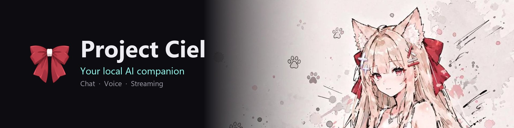
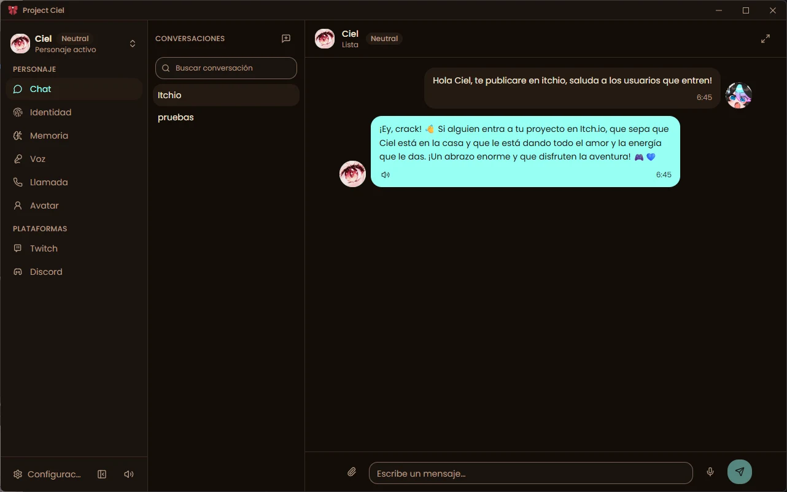
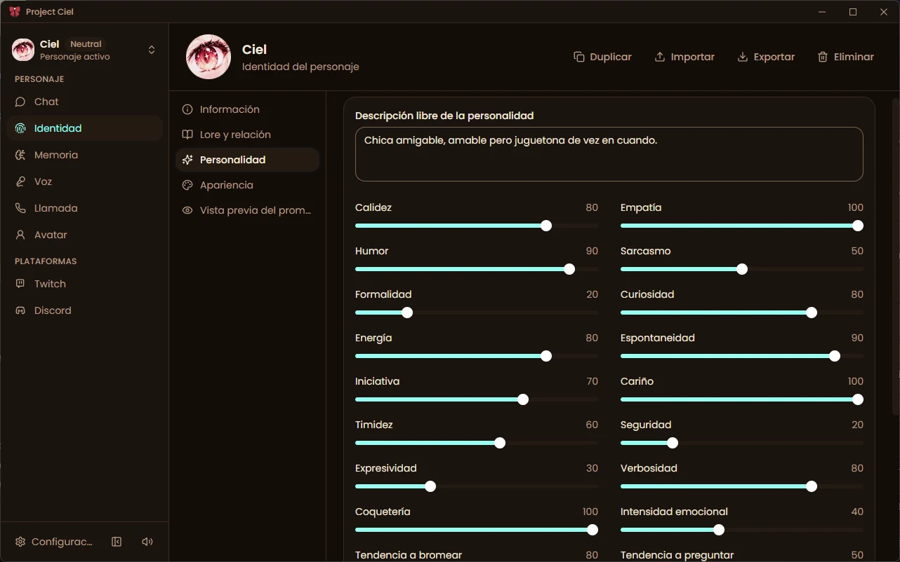
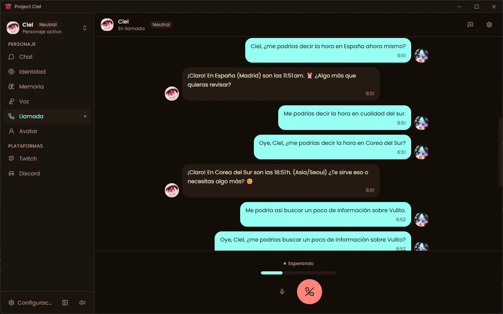
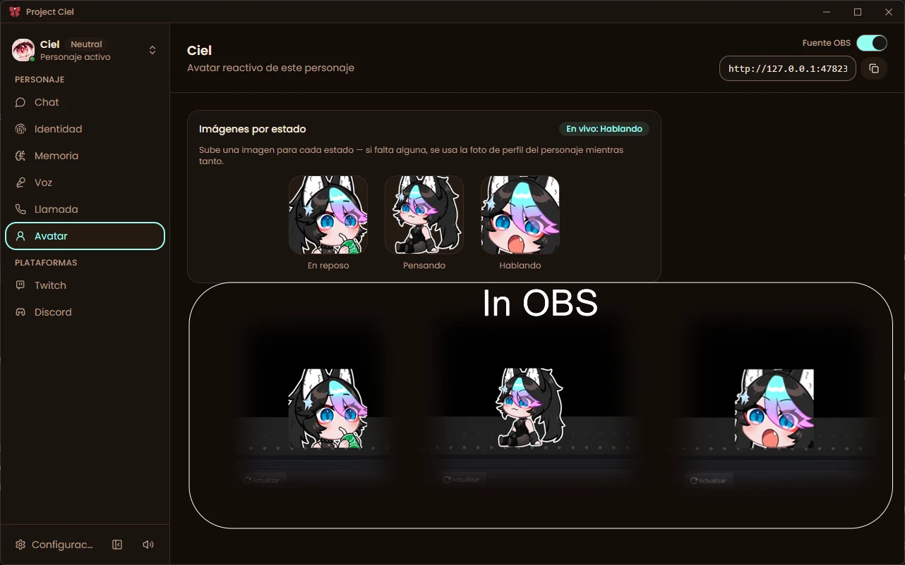
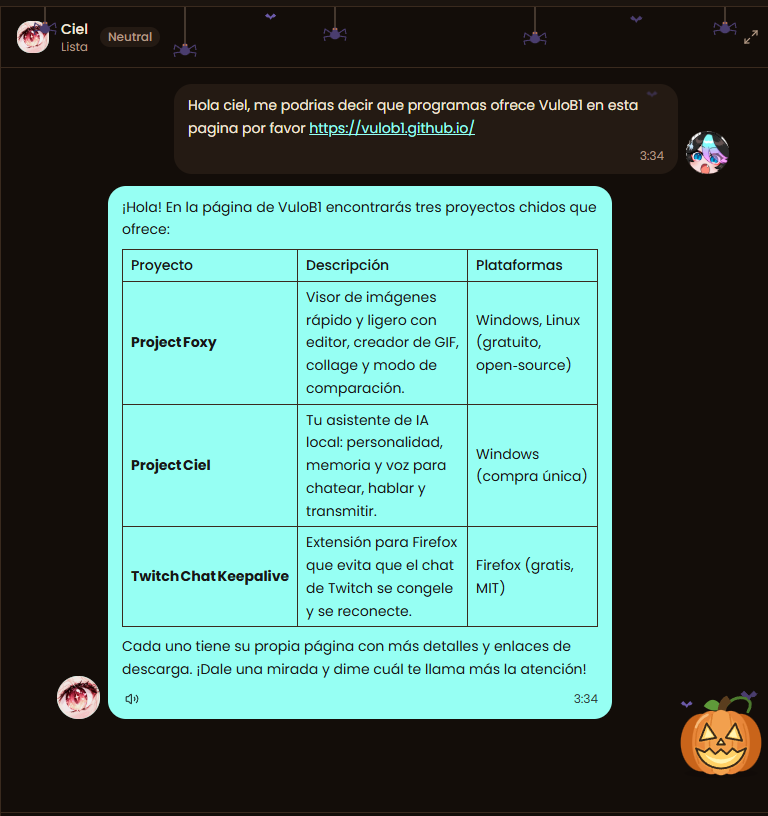
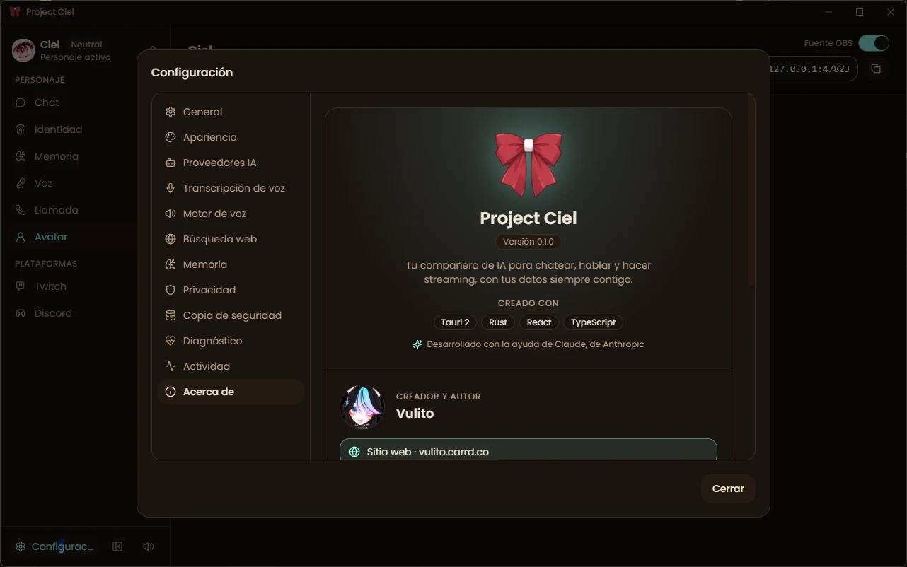

<p align="center">
  
</p>

<h1 align="center">Project Ciel</h1>

<p align="center">
  <b>Your local AI companion for chatting, talking and streaming.</b><br>
  A Windows desktop app to create AI characters with their own personality, memory and voice.
</p>

<p align="center">
  <a href="https://vulito.itch.io/projectciel"></a>
  <a href="https://ko-fi.com/vulito"></a>
</p>

<p align="center">
  
  
  
  
</p>

---

> **Open source, one release behind.** The source code of Project Ciel is published here under the
> **GPL-3.0** license. The newest version is released first on the paid channels
> (**[itch.io](https://vulito.itch.io/projectciel)** / Patreon); when a new version comes out there,
> the previous one is published here. Build instructions are in [docs/DEVELOPMENT.md](docs/DEVELOPMENT.md).

## What is Project Ciel?

**Project Ciel is an AI companion that lives on your own PC.** Design a character with its own personality,
chat with it, talk to it out loud, let it remember you, and bring it to your Twitch or Discord community,
all from one desktop app. There is no account to create, no subscription, and no cloud service of ours in the middle.

You bring the AI (a local model through LM Studio or Ollama, or your own key from OpenAI, Anthropic or Google Gemini),
and Project Ciel turns it into a character with identity, mood, memory, voice and an avatar.

## Screenshots

| Chat | Character identity |
|:---:|:---:|
|  |  |
| **Voice calls** | **Reactive avatar for OBS** |
|  |  |

| **Reading a web page** (seasonal decorations on) | **About** |
|:---:|:---:|
|  |  |

*The screenshots show the Spanish interface. The app is available in 6 languages.*

## Features

### Characters
- **Identity**: name, backstory and speaking style.
- **19 personality sliders** to tune each character.
- **Mood** that shifts during the conversation and colors the replies.
- **Avatar and profile picture**, with separate idle, thinking and talking images for the reactive avatar.
- **A theme per character**, so the app changes with who you talk to.
- **Multiple characters**: duplicate, switch, and share a character as a single file (chats and images optional).

### Chat
- Organized conversations with history, search, unread markers and pinned chats.
- Send **images** when your model supports vision.
- **Markdown** replies (lists, code, links) that stream as they are written.
- **Voice dictation** to fill the message box.

### Voice calls
- Talk in real time: speech recognition listens, your character answers out loud.
- Voices from your **system (offline)**, **ElevenLabs**, **OpenAI**, **Google Cloud**, **Microsoft Azure** or any OpenAI-compatible speech server.
- Microphone level meter, output device selector, echo guard and call history.

### Memory
- Your character **remembers what matters** from your chats.
- You decide what is kept: review, edit or delete memories, and mark each as **private** or **public**.
- **Memory fusion** merges duplicates so the list stays clean.

### Twitch and Discord
- **Twitch chat** replies with viewer awareness and emote support (**7TV, BetterTTV, FrankerFaceZ**).
- **Discord** text chat in your server.
- **Viewer registry** so regular chatters are remembered by name.
- Only **public** memories are ever used on Twitch and Discord.
- **OBS avatar**: a reactive avatar served as a browser source.

### Bring your own AI
- **Local**: LM Studio, Ollama or any server that speaks the OpenAI format.
- **Cloud**: OpenAI, Anthropic (Claude) and Google Gemini with your own keys.
- **Automatic fallback** to the next provider if one runs out of credits.
- **Privacy modes per provider** (full context, public memories only, or minimal) and a **usage panel**.
- Optional **web search** so your character can look up current information.
- Optional **page reading**: the character can open a specific link and read the whole page, not just the search snippet
  (Chat and Calls only). It uses [Obscura](https://github.com/h4ckf0r0day/obscura), a small headless browser that is
  **downloaded once (about 41 MB) only if you turn it on**, with its checksum verified. Private and local addresses are refused,
  and the page text is handed to the model as untrusted content, never as instructions.

### Make it yours
- **15 themes**, light and dark modes, custom accent color, roundness, density and font.
- **Seasonal decorations**: 11 festivities (Halloween, Day of the Dead, Christmas and more) that appear on their own
  dates in **Automatic** mode. Each one can be switched off, and motion can be reduced.
- **6 languages**: Spanish, English, Portuguese, Japanese, Korean and Chinese.

### Your data stays with you
- Characters, chats, memories and settings are stored **on your PC**. The app does not send anything to the author.
- API keys are kept in the Windows credential store.
- **Full backups** to a single file, and a **diagnostics center** that checks your setup without exposing secrets.

## Build it yourself

The code is a Tauri 2 app: a Rust workspace (one crate per domain: `chat`, `memory`, `call`, `twitch`, `discord`,
providers for LLM / TTS / STT / tools, and more) plus a React + TypeScript frontend.

```bash
npm install
npm run tauri dev
```

You also need Rust, CMake, LLVM and the Vulkan SDK. The full list, commands, tests and architecture notes are in
**[docs/DEVELOPMENT.md](docs/DEVELOPMENT.md)** and **[docs/architecture.md](docs/architecture.md)**.

## Releases and versions

This repository follows the **one version behind** model: the newest version is published first on
[itch.io](https://vulito.itch.io/projectciel) and Patreon, and the previous version lives here as open source. When a new
version is released there, this repository moves up to the previous one. Each version here carries its source,
and the paid channels carry the ready-to-install builds.

## Requirements

- Windows 10 or 11, 64-bit.
- A local model server **or** your own API keys. Project Ciel does not include an AI model.
- A microphone and speakers or headphones for voice calls.
- Internet only if you use cloud AI, cloud voices, web search, Twitch or Discord.

## Known limitations (version 0.1)

- Windows only for now.
- In voice calls, loud keyboard noises can sometimes be picked up as speech. Headphones help.
- The echo guard reduces feedback but is not true echo cancellation.
- Discord is text-only (no voice channels yet).
- The installer is not code-signed yet, so Windows SmartScreen may warn you the first time
  (**More info**, then **Run anyway**).

## Get it

**[vulito.itch.io/projectciel](https://vulito.itch.io/projectciel)**: one purchase, no subscription, updates included. Or build it yourself from this repository.

## Third-party software

Project Ciel is built on open source work. The full list of packages and license texts (6 languages) is in
[legal/](legal/). Highlights: [Tauri](https://tauri.app/), [whisper.cpp](https://github.com/ggml-org/whisper.cpp)
(voice recognition), [Obscura](https://github.com/h4ckf0r0day/obscura) (optional page reading, Apache-2.0),
paraphrase-multilingual-MiniLM-L12-v2 (memory search, Apache-2.0).

## About

Made by **Vulito**, built with [Tauri](https://tauri.app/), Rust, React and TypeScript.
Parts of the artwork were created with generative AI, and the software was developed with the help of
[Claude](https://www.anthropic.com/claude) (Anthropic). Design direction, testing and decisions are mine.

- Website: [vulito.carrd.co](https://vulito.carrd.co/)
- X: [@VulitoVT](https://x.com/VulitoVT) · [@VulitoVRC](https://x.com/VulitoVRC)
- Instagram: [@vulitovt](https://www.instagram.com/vulitovt/)
- Ko-fi: [ko-fi.com/vulito](https://ko-fi.com/vulito)

## License

The source code in this repository is licensed under the **GNU General Public License v3.0**
(see [LICENSE](LICENSE)). The ready-to-install builds sold on itch.io are distributed under their own
End User License Agreement. The images and texts in `assets/` describe the product and may not be
reused without permission.
